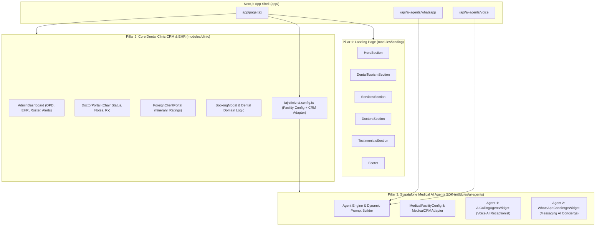

# Industry Architecture & Product Blueprint (`ARCHITECTURE.md`)

## Overview

This repository is engineered using an industry-standard **3-Pillar Modular Architecture**. It powers **Taj White Pearl Dental Hospital & Luxury Spa (Agra)** while simultaneously packaging its **AI Agent Suite** as a standalone, white-label B2B healthcare product that can be embedded into any hospital, clinic, or existing medical CRM.



---

## Pillar 1: Landing Page (`modules/landing/`)
- **Purpose**: High-conversion public showcase for local patients and international dental tourists.
- **Components**:
  - `HeroSection`: Brand positioning, quick CTAs for booking, AI Voice Receptionist, and WhatsApp Concierge.
  - `DentalTourismSection`: 4-day Agra dental vacation itinerary and interactive UK/US vs. Clinic savings calculator.
  - `ServicesSection`: Filterable clinical procedure catalog with duration and pricing.
  - `DoctorsSection`: Specialist credentials, ratings, suites, and consultation fees.
  - `TestimonialsSection`: Verified local and international patient stories.
  - `Footer`: Hospital accreditations, address, and instant concierge triggers.

---

## Pillar 2: Core Dental Clinic CRM, EHR & Portals (`modules/clinic/`)
- **Purpose**: Full-featured clinic management system for receptionists, doctors, administrators, and patients.
- **Sub-systems**:
  1. **Hospital Administration (`AdminDashboard.tsx`)**:
     - Live KPI metrics (total bookings, active queue, foreign tourists, local OPD, specialist roster, average rating).
     - Master Bookings & Walk-in OPD intake table with search, status filters, origin filters, fast status transitions, and rescheduling.
     - Patient EHR Directory with medical alerts, allergies, passport tracking, and complete visit history drawer.
     - Specialist Doctor Roster management (add new specialists dynamically).
     - Automated WhatsApp & Email Notification Center with live message preview and manual trigger testing.
  2. **Clinician Workstation (`DoctorPortal.tsx`)**:
     - Clinician switcher, daily patient queue, chair status progression (`confirmed` -> `arrived` -> `in_chair` -> `completed`), clinical findings editor, and prescription (`Rx`) logging.
  3. **International Client Portal (`ForeignClientPortal.tsx`)**:
     - VIP dental tourist dashboard with assigned specialist details, hotel/airport chauffeur status, inline slot rescheduling, digital dental passport download, and 5-star review submission.
  4. **Booking Engine & Domain Logic (`BookingModal.tsx`, `domain/dental-logic.ts`)**:
     - Real-time doctor slot conflict validation (`isDoctorSlotAvailable`), appointment number generation, multi-currency display, and automatic dual-channel (WhatsApp + Email) confirmation dispatch.

---

## Pillar 3: Reusable Medical AI Agents Product / SDK (`modules/ai-agents/`)
- **Purpose**: Many hospitals and clinics already have an existing website, EHR, or CRM in place—what they lack is an intelligent, medical-grade AI layer. Pillar 3 is architected as a **drop-in, white-label AI Agent Suite** containing two specialized agents:
  1. **Agent 1 — AI Voice Calling Agent (`AICallingAgentWidget` + `/api/ai-agents/voice`)**:
     - Browser Web Speech API (STT + TTS) + Gemini structured JSON generation + deterministic fallback engine.
     - Handles inbound/outbound patient calls, answers clinical/pricing FAQs, books new appointments, reschedules slots, and cancels appointments with structured data extraction.
  2. **Agent 2 — AI WhatsApp Concierge Agent (`WhatsAppConciergeWidget` + `/api/ai-agents/whatsapp`)**:
     - End-to-end encrypted WhatsApp Business UI + Gemini conversational engine + deterministic action handler.
     - Handles natural-language slot rescheduling, star rating & review collection, travel/shuttle coordination, and instant escalation to the Voice AI Agent.

### How Any Other Hospital or Clinic Integrates Pillar 3

To embed the AI Agents into **any other medical system** (e.g., an Cardiology Hospital, Dermatology Clinic, or Eye Care Center), the host system only needs to provide:
1. A **`MedicalFacilityConfig`** JSON/object describing their hospital, doctors, services, and agent persona.
2. A **`MedicalCRMAdapter`** object mapping agent actions (`onBookAppointment`, `onRescheduleAppointment`, `onCancelAppointment`, `onSubmitReview`) to their existing database or REST/GraphQL CRM APIs.

```tsx
import {
  AICallingAgentWidget,
  WhatsAppConciergeWidget,
  MedicalFacilityConfig,
  MedicalCRMAdapter,
} from '@/modules/ai-agents';

// 1. Define any medical facility configuration (e.g., Apollo Heart Institute)
const hospitalConfig: MedicalFacilityConfig = { ... };

// 2. Connect to existing hospital CRM / EHR APIs
const crmAdapter: MedicalCRMAdapter = {
  appointments: existingCrmAppointments,
  doctors: existingHospitalDoctors,
  onBookAppointment: async (apt) => await myHospitalCRM.createBooking(apt),
  onRescheduleAppointment: async (code, date, time) => await myHospitalCRM.reschedule(code, date, time),
  onCancelAppointment: async (code) => await myHospitalCRM.cancel(code),
  onSubmitReview: async (code, rating, feedback) => await myHospitalCRM.saveFeedback(code, rating, feedback),
};

// 3. Render the drop-in AI Agents
<AICallingAgentWidget isOpen={voiceOpen} onClose={...} config={hospitalConfig} crm={crmAdapter} />
<WhatsAppConciergeWidget isOpen={waOpen} onClose={...} config={hospitalConfig} crm={crmAdapter} />
```

